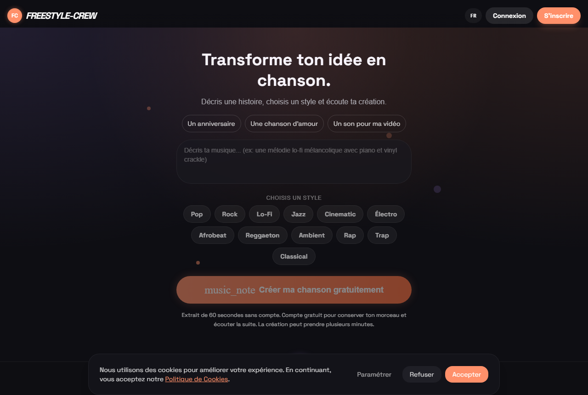

# Freestyle Crew — chansons IA et battles freestyle

**▶ Site en ligne : [freestyle-crew.com](https://freestyle-crew.com)**
Par [John Dossin](https://dossin.rvlts.com) · portfolio complet : [dossin.rvlts.com](https://dossin.rvlts.com)

« **Transforme ton idée en chanson** » : un créateur musical IA (description → style → chanson générée), la **plateforme de battles du crew** avec uploads audio/vidéo, une app Android, et le clip IA « Légende » livré pour le crew.

> ℹ️ Ce dépôt est une **vitrine** : le code source est privé (client réel, données utilisateurs). Accès en lecture sur demande pour un entretien — dossinjohn@gmail.com.

## Décisions d'ingénierie

- **Génération musicale en file d'attente plutôt qu'en requête HTTP** — une chanson prend des minutes, le navigateur ne doit jamais attendre : job asynchrone et polling.
- **Cluster Node ×4 derrière nginx** — les uploads audio/vidéo et les pics de charge des battles ne font pas tomber la plateforme ; éprouvé en conditions réelles.
- **Client réel, contrainte créative externe** — un livrable validé par quelqu'un d'autre que moi.

## Stack

| Couche | Technologies |
|---|---|
| Plateforme | Node.js · Express · socket.io |
| Génération | Musique IA en jobs asynchrones |
| Exploitation | Cluster PM2 ×4 · nginx · TLS · uploads audio/vidéo |
| Mobile | App Android (APK) livrée |

## Le clip « Légende »

Clip musical IA de 2 min 29 pour une chanson du crew : 29 plans, personnages cohérents du premier au dernier plan, calculé en local sur une seule RTX 3080 (10 Go). À voir sur [dossin.rvlts.com](https://dossin.rvlts.com/#pipelines).

## Décidé · Délégué · Vérifié

| Décidé (moi) | Délégué (agents IA) | Vérifié (moi) |
|---|---|---|
| Jobs asynchrones pour la génération | Code de la plateforme | Charge réelle absorbée en prod |
| Architecture cluster et stockage | App Android associée | Livrable accepté par le client |
| Cahier des charges avec le crew | | |
